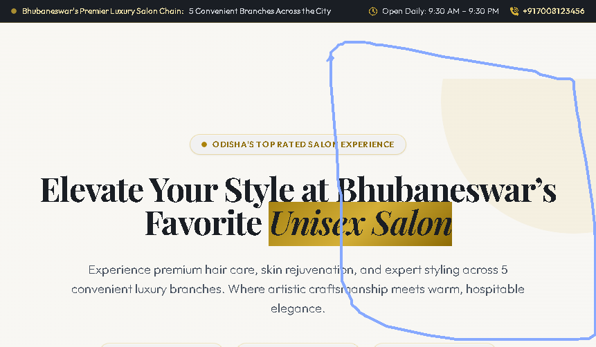

# Coral Unisex Salon Bhubaneswar

> Premier luxury unisex salon chain across 5 prime locations in Bhubaneswar: **Nayapalli**, **Khandagiri**, **Baramunda**, **Kalinga Vihar**, and **Jaydev Vihar**.



## ✨ Features

- **5-Branch Locator & Selector**: Seamlessly switch between Bhubaneswar branches to see exact addresses, timings, and direct calling links.
- **Curated Menu & Treatment Catalog**: Real-time filtering and search for Hair Care, Skin Rejuvenation, Keratin & Botox, Bridal Suites, and Men's Grooming.
- **Before & After Transformation Gallery**: Visual interactive comparison cards showcasing client transformations.
- **3-Step WhatsApp Booking System**: Pick branch, choose services and time slots, and get a formatted WhatsApp confirmation message ready to send.
- **Responsive & High-Aesthetic Design**: Crafted with gold marble luxury accents, fluid animations, and mobile-friendly drawer navigation.

## 🚀 Getting Started

### Prerequisites
- Node.js (v18 or higher recommended)
- npm

### Installation & Local Run
1. Clone the repository:
   ```bash
   git clone https://github.com/adment2005-boop/coralsalon.git
   cd coralsalon
   ```

2. Install dependencies:
   ```bash
   npm install
   ```

3. Start development server:
   ```bash
   npm run dev
   ```
   Open `http://localhost:3000` in your browser.

4. Build for production:
   ```bash
   npm run build
   ```

## 🛠️ Tech Stack
- **Vite**
- **React & TypeScript**
- **Tailwind CSS**
- **Lucide Icons & FontAwesome**
- **Google Fonts** (Cinzel, Playfair Display, Outfit)
